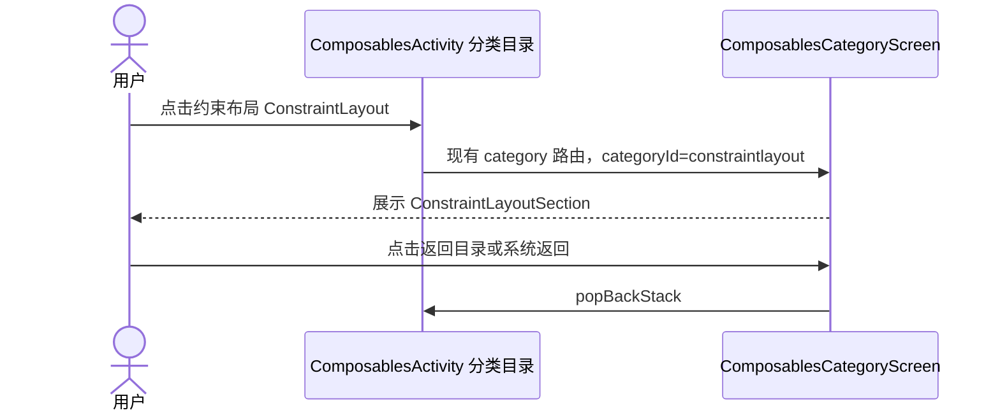

# ConstraintLayout Compose 用法示例技术 Spec

> 来源：用户要求「添加一个 ConstraintLayout 用法示例，并在 ComposablesActivity 页面添加入口」
> 日期：2026-10-16 ｜ 状态：**已按本方案实施并实机验证**（实施记录见第 7 节）

## 1. 需求澄清

- 使用 Compose 版 `androidx.constraintlayout.compose.ConstraintLayout`，不是 XML/View 版。
- 沿用现有分类二级页：在 ComposablesActivity 的分类目录中，紧接「布局 Layout」添加「约束布局 ConstraintLayout」（`id = "constraint"`）。不新增 Activity、不注册 Manifest、不加启动图标。
- 用户已确认本入口形式与示例范围，并要求「用法尽可能实现」，因此实施范围从 3 组扩到 10 组（见第 2 节）。

## 2. 功能拆解

| # | 示例块 | 覆盖的 API | 可观察结果 |
|---|---|---|---|
| 1 | 基础约束 | `createRefs`、`constrainAs`、`linkTo(margin)`、`Dimension.fillToConstraints` | 头像 / 标题 / 说明 / 标签按相互关系排布 |
| 2 | Dimension 四种宽度写法 | `wrapContent`、`fillToConstraints`、`value`、`percent` | 只有 fillToConstraints 顶到右边，其余各按自身规则 |
| 3 | bias 对照（易错点） | `horizontalBias` | 只约束单边时 bias 无效（贴左），两端都约束才居中 |
| 4 | Guideline | `createGuidelineFromStart(0.4f)`、`createGuidelineFromTop(56.dp)` | 按 40% 与 56dp 切分出的两块区域 |
| 5 | Barrier | `createEndBarrier(..., margin)` | 对齐线随较长一行自动右移 |
| 6 | Chain | `createHorizontalChain` + `ChainStyle.Spread / SpreadInside / Packed` | 三行圆点的三种排布差异 |
| 7 | dimensionRatio | `Dimension.ratio("16:9")`、`Dimension.ratio("1:1")` | 160dp×90dp 与 88dp×88dp 两块 |
| 8 | Visibility.Gone | `visibility = Visibility.Gone / Visible` | 点按钮后第三块自动上顶，中间块不再占位 |
| 9 | ConstraintSet | `ConstraintSet { createRefFor / constrain }` + `Modifier.layoutId` | 点按钮在同一份内容上切换卡片布局 / 上下布局 |
| 10 | 易错点：漏写 constrainAs | 未约束子项的行为 | 未 constrainAs 的方块压到左上角并与首个元素重叠 |

示例复用 `ExampleBlock` / `ExampleLabel` / `ResultText`，提供中文说明与关键代码注释，使用 MaterialTheme 的颜色和字体。

## 3. 页面流程

## 4. 数据与状态

- 仅本地布局教学演示，不访问网络、Room 或 DataStore，无领域模型、Repository、UseCase。
- 默认使用静态展示，无需新增 ViewModel。若具体实现需要演示文本长短切换，仅使用生命周期内的局部 UI 状态，不引入业务数据状态。
- 二级页已经承载纵向滚动；示例不嵌套同方向滚动容器，不使用无界高度下的 fillToConstraints。

## 5. 依赖及影响文件

1. `gradle/libs.versions.toml`：新增 ConstraintLayout Compose 版本与库别名。
2. `demo/build.gradle.kts`：仅 :demo 引用新依赖。
3. `demo/src/main/java/com/development/demo/ui/composables/ComposablesCategory.kt`：添加分类入口与 Section 引用。
4. `demo/src/main/java/com/development/demo/ui/composables/sections/ConstraintLayoutSection.kt`：新增示例。

本机已有 ConstraintLayout Compose Android 1.1.2 的 Gradle 缓存，可作为优先候选；实际依赖兼容性以 Gradle 解析与编译结果为准。版本统一通过 Version Catalog 管理，不修改锁文件、不升级现有 Compose BOM。

不改 :base/:app，不改现有分页列表、其它示例、公共主题与导航骨架。

## 6. 异常与边界

- 不需要登录、权限或网络；离线时示例仍可展示。
- 文本不依赖固定像素坐标；使用 start/end 约束并留足内容尺寸。
- 宽度填充示例必须同时约束 start/end；不通过制造崩溃来演示错误。
- 新依赖若解析失败，报告具体原因，不绕过项目版本约束。

## 7. 验收标准与实施记录

验收（全部通过）：

- [x] ComposablesActivity 分类目录存在「约束布局 ConstraintLayout」入口，点击进入对应二级页。
- [x] 示例实际使用 ConstraintLayout Compose API，不用 Row/Column 假冒约束关系。
- [x] 基础布局、辅助约束和宽度易错点对照均有可观察内容与中文说明（10 个示例块）。
- [x] 顶部返回与系统返回均回到原目录。
- [x] `git diff --check` 通过。
- [x] `./gradlew :demo:compileDebugKotlin` 与 `./gradlew :demo:assembleDebug` 成功（0 error / 0 warning）。
- [x] 在 `emulator-5554`（Medium_Phone_android15_API35）上安装验证：逐块截图比对渲染结果，两个交互按钮（Visibility 切换、ConstraintSet 切换）真实点击验证，全程 `FATAL EXCEPTION` 计数为 0；未安装到用户真机。

实现记录（与初版方案的差异）：

1. 依赖锁定 `androidx.constraintlayout:constraintlayout-compose:1.1.2`（本机 Gradle 缓存已有该版本的 android 构件）。
2. 实施中发现并修正两处版式问题：基础约束的标题在 start/end 双约束下默认居中，改为 `horizontalBias = 0f` 贴住头像；ConstraintSet 的「上下布局」变体原本让头像与标题重叠，改为标题挂在 `avatar.bottom` 下方。
3. 示例块由 3 组扩展到 10 组，覆盖 `createRefs / constrainAs / linkTo / Dimension / bias / Guideline / Barrier / Chain / ratio / Visibility / ConstraintSet`。
